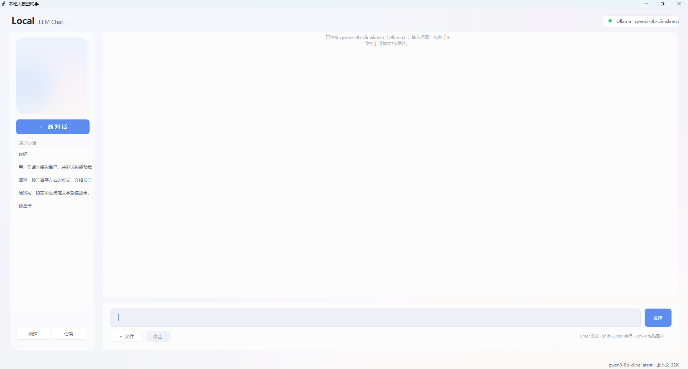

# Local LLM Chat

**English** | [简体中文](README.zh-CN.md)

> A desktop chat client for **any local LLM** — Ollama, LM Studio, llama.cpp, vLLM, Jan and more.
> Pure Python + tkinter. No Electron, no Node, no bundled web server.



## Features

- **Multi-backend** — Ollama native protocol plus OpenAI-compatible endpoints, covering nearly every local inference server
- **Reads your files** — PDF, Word, Excel, PowerPoint, CSV, Markdown, source code, EPUB, RTF
- **Understands images** — automatically routes to a vision model (if configured); paste screenshots with `Ctrl+V`
- **Streaming output** — token by token, stoppable at any moment
- **Multi-turn sessions** — conversations are saved locally, can be revisited or deleted
- **Live throughput** — estimated tok/s while generating, exact numbers afterwards (TTFT, prompt speed)
- **Benchmark panel** — repeatable speed test with a comparison table
- **Glassmorphism UI** — rounded cards, frosted background, custom window and sidebar images
- **Zero config** — auto-detects the first available model after connecting

## Quick start

```bash
# 1. install dependencies (this is an inference client — no PyTorch needed)
pip install -r requirements.txt

# 2. start any local inference server, e.g.
ollama serve

# 3. run
python qwen_chat.py
```

If the app says "no model connected yet":

1. Click **Settings** (bottom-left)
2. Pick a **preset** (Ollama / LM Studio / llama.cpp …) — the URL is filled in for you
3. Click **Test** to verify connectivity
4. Click **Fetch list**, choose a model
5. **Save**

## Supported services

| Service | Protocol | Default URL |
|---|---|---|
| [Ollama](https://ollama.com) | `ollama` | `http://127.0.0.1:11434` |
| [LM Studio](https://lmstudio.ai) | `openai` | `http://127.0.0.1:1234` |
| [llama.cpp (llama-server)](https://github.com/ggml-org/llama.cpp) | `openai` | `http://127.0.0.1:8080` |
| [vLLM](https://github.com/vllm-project/vllm) | `openai` | `http://127.0.0.1:8000` |
| [Jan](https://jan.ai) | `openai` | `http://127.0.0.1:1337` |
| [LocalAI](https://localai.io) | `openai` | `http://127.0.0.1:8080` |
| [text-generation-webui](https://github.com/oobabooga/text-generation-webui) | `openai` | `http://127.0.0.1:5000` |
| [KoboldCpp](https://github.com/LostRuins/koboldcpp) | `openai` | `http://127.0.0.1:5001` |
| Anything else OpenAI-compatible | `openai` | custom |

> Any server exposing `/v1/chat/completions` with streaming will work.

## Files and images

| Type | Formats | How it is handled |
|---|---|---|
| Documents | `.pdf` `.docx` `.xlsx` `.pptx` `.rtf` `.epub` | Text extraction (PDF per page, Excel per sheet, PPT per slide) |
| Text | `.txt` `.md` `.csv` `.json` `.log` `.yaml` `.html` | Read directly, UTF-8 / GBK auto-detected |
| Code | `.py` `.js` `.java` `.c` `.go` `.sql` and 30+ more | Treated as plain text |
| Images | `.png` `.jpg` `.webp` `.bmp` `.gif` | Sent to the vision model (if configured) |

- Use **+ File**, or paste a screenshot/file with `Ctrl+V`
- 80 MB per file, up to 12 attachments at once
- Long documents are truncated proportionally and reported inline

**About images:** text-only models cannot see images. If your server has a vision model
(`qwen3-vl`, `llava`, `minicpm-v`, …), put its name in **Settings → Vision model** and
image messages will switch to it automatically. Leave it empty to send images to the main model.

## Customization

**Settings → Appearance** lets you pick a window background and a sidebar image — applied instantly.

Or replace the files directly (priority top to bottom):

```
assets/background.jpg     your own window background
assets/default_bg.jpg     the neutral fallback shipped with the repo
assets/side_card.jpg      your own sidebar card
assets/default_side.jpg   the neutral fallback
```

Colors live in the constants block at the top of `qwen_chat.py`;
blur and opacity are tuned in `_make_backdrop()` / `_panel_image()`.

## Project layout

```
qwen_chat.py      main app: UI, sessions, attachments, benchmark
providers.py      backend adapters: Ollama / OpenAI-compatible
extract.py        document parsing: PDF, Office, text, images
assets/           default background and sidebar images
docs/             screenshots
requirements.txt  third-party dependencies
```

## Requirements

- Python **3.10+**
- Windows / macOS / Linux (the default font `Microsoft YaHei UI` falls back gracefully elsewhere)
- You bring the model and the server; this project is only the client

## FAQ

**`No module named 'PIL'` on startup**
→ `pip install -r requirements.txt`

**"Test" fails in settings**
→ Make sure the server is running; Ollama listens on `127.0.0.1` only by default

**The model says it cannot see my image**
→ The main model is text-only; configure a vision model in settings

**Fonts render as boxes**
→ Your system lacks `Microsoft YaHei UI`; change `FONT_FAMILY` in `qwen_chat.py`

## License

[MIT](LICENSE).

The bundled default images are programmatically generated gradients with no licensing
constraints. The repository deliberately ships **no** third-party artwork —
`assets/background.jpg` and `assets/side_card.jpg` are gitignored so you can drop in your own.
