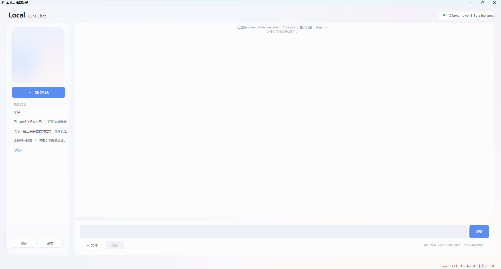

# Local LLM Chat · 本地大模型助手

[English](README.md) | **简体中文**

[](https://github.com/Kezyoow/local-llm-chat/actions/workflows/ci.yml)
[](LICENSE)
[](https://www.python.org)

> 一个能接入**任何本地大模型**的桌面聊天客户端。纯 Python + tkinter，无 Electron、无 Node、无内置 Web 服务。



## 特性

- **多后端**：Ollama 原生协议 + OpenAI 兼容协议，覆盖几乎全部本地推理服务
- **文件阅读**：PDF / Word / Excel / PPT / CSV / Markdown / 代码 / EPUB / RTF
- **图片理解**：自动切换到视觉模型（若已配置），支持 `Ctrl+V` 粘贴截图
- **流式输出**：逐字显示，可随时停止
- **多轮会话**：历史对话自动保存，可回看、删除
- **实时速度**：生成中显示估算 tok/s，结束后给出精确值（首字延迟、提示词处理速度）
- **测速面板**：固定条件跑基准，多次结果可对比
- **拖拽上传**：文件直接拖进窗口即可，图片附件带缩略图
- **深浅主题**：设置里一键切换，立即生效无需重启
- **玻璃拟态界面**：圆角卡片、磨砂背景，可自定义窗口背景与侧栏图片
- **零配置**：连上服务后自动拉取模型列表

## 快速开始

```bash
# 1. 装依赖（这是推理客户端，不需要 PyTorch）
pip install -r requirements.txt

# 2. 启动任意本地推理服务，例如
ollama serve

# 3. 运行
python qwen_chat.py
```

首次打开若提示"还没有连接模型"：

1. 点左下角 **设置**
2. **常用预设**里选一个（Ollama / LM Studio / llama.cpp …），地址自动填好
3. 点 **测试** 确认连通
4. 点 **获取列表**，下拉选一个模型
5. **保存**

之后启动会记住配置（存在 `settings.json`，已加入 `.gitignore`）。

## 支持的服务

| 服务 | 协议 | 默认地址 |
|---|---|---|
| [Ollama](https://ollama.com) | `ollama` | `http://127.0.0.1:11434` |
| [LM Studio](https://lmstudio.ai) | `openai` | `http://127.0.0.1:1234` |
| [llama.cpp (llama-server)](https://github.com/ggml-org/llama.cpp) | `openai` | `http://127.0.0.1:8080` |
| [vLLM](https://github.com/vllm-project/vllm) | `openai` | `http://127.0.0.1:8000` |
| [Jan](https://jan.ai) | `openai` | `http://127.0.0.1:1337` |
| [LocalAI](https://localai.io) | `openai` | `http://127.0.0.1:8080` |
| [text-generation-webui](https://github.com/oobabooga/text-generation-webui) | `openai` | `http://127.0.0.1:5000` |
| [KoboldCpp](https://github.com/LostRuins/koboldcpp) | `openai` | `http://127.0.0.1:5001` |
| 其它 OpenAI 兼容服务 | `openai` | 自定义 |

> 只要提供 `/v1/chat/completions` 流式接口，都能接。

## 文件与图片

| 类型 | 格式 | 处理方式 |
|---|---|---|
| 文档 | `.pdf` `.docx` `.xlsx` `.pptx` `.rtf` `.epub` | 抽取文字（PDF 按页 / Excel 按工作表 / PPT 按页） |
| 文本 | `.txt` `.md` `.csv` `.json` `.log` `.yaml` `.html` | 直接读取，自动识别 UTF-8 / GBK |
| 代码 | `.py` `.js` `.java` `.c` `.go` `.sql` 等 30+ | 当纯文本 |
| 图片 | `.png` `.jpg` `.webp` `.bmp` `.gif` | 交给视觉模型（需在设置里配置） |

- 点 **＋ 文件** 选择文件，或直接在输入框 `Ctrl+V` 粘贴截图/文件
- 单个文件上限 80MB，一次最多 12 个
- 文档过长会按比例截断，并在对话里用 `[提示]` 告知截断量

**关于图片**：纯文本模型看不懂图。如果你的服务里有视觉模型（`qwen3-vl`、`llava`、`minicpm-v` 等），
在设置的「视觉模型」里填上名字，带图片的消息会自动切过去；留空则把图片直接发给主模型。

## 自定义外观

**设置 → 外观** 里可以直接选背景图和侧栏图片，选完立即生效。

也可以手动替换文件（优先级从上到下）：

```
assets/background.jpg     你自己的窗口背景
assets/default_bg.jpg     仓库自带的中性渐变图
assets/side_card.jpg      你自己的侧栏卡片
assets/default_side.jpg   仓库自带的默认卡片
```

配色在 `qwen_chat.py` 顶部常量区；模糊与透明度在 `_make_backdrop()` / `_panel_image()`。

## 项目结构

```
qwen_chat.py      主程序：界面、会话、附件、测速
providers.py      后端适配层：Ollama / OpenAI 兼容
extract.py        文件解析：PDF、Office、文本、图片
assets/           默认背景与侧栏图
docs/             截图
requirements.txt  第三方依赖
```

## 运行要求

- Python **3.10+**
- Windows / macOS / Linux（字体默认 `Microsoft YaHei UI`，其它系统会自动回退）
- 模型与服务自己准备，本项目只做客户端

## 界面说明

| 位置 | 功能 |
|---|---|
| 左上 | 当前后端与模型 |
| 右上 | 服务状态（绿点=在线） |
| 左栏 | 新对话 / 历史对话 / 测速 / 设置 |
| 中间 | 对话区（右键气泡可复制） |
| 底部 | 输入框 + 发送 + 添加文件 + 停止 |
| 右下 | 实时速度与 token 统计 |

## 常见问题

**启动报 `No module named 'PIL'`**
→ `pip install -r requirements.txt`

**设置里"测试"失败**
→ 确认服务已启动；Ollama 默认只监听 `127.0.0.1`

**发了图片但模型说看不到**
→ 主模型是纯文本模型，需要在设置里配置视觉模型

**界面字体变成方块**
→ 系统没有 `Microsoft YaHei UI`，改 `qwen_chat.py` 里的 `FONT_FAMILY`

## 隐私

- 所有请求只发往**你自己配置**的本地地址（默认 `127.0.0.1`），不经过任何第三方服务器或代理
- 没有遥测、没有崩溃上报、没有版本检查请求
- 文件是**就地读取**的：不复制、不上传、不写入数据库；解析出的文本只在内存里，会话结束即释放
- 会话记录是纯 JSON，存在本地 `sessions/`，随时可删（已加入 `.gitignore`）

## 贡献

欢迎提 Issue 和 PR，细节见 [CONTRIBUTING.md](CONTRIBUTING.md)（环境准备、如何新增后端、提交规范）。
版本历史见 [CHANGELOG.md](CHANGELOG.md)。

## 许可

[MIT](LICENSE)。

仓库自带的默认图片是程序生成的渐变图，无版权限制。仓库**不包含**任何二次元人物素材——
`assets/background.jpg` 与 `assets/side_card.jpg` 已在 `.gitignore` 中排除，请自备。
